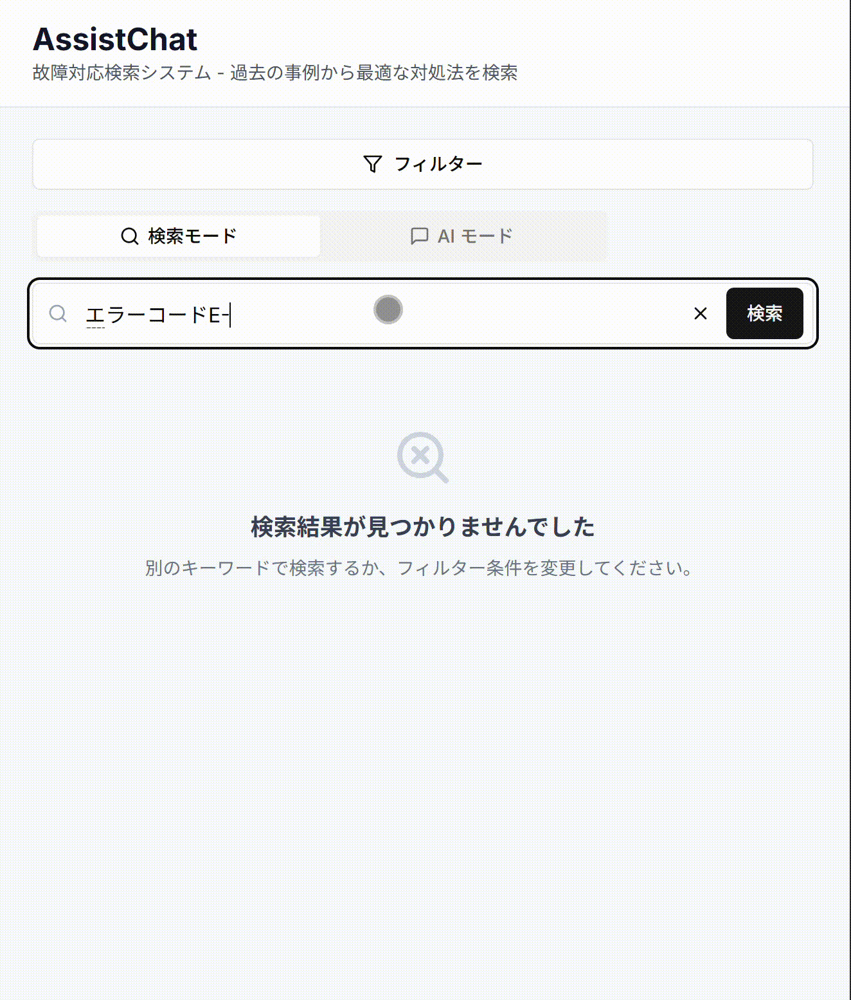

# AssistChat

[](https://github.com/RyugoHori/AssistChat-Portfolio/actions/workflows/ci.yml)

**工場の保全記録を、ふだんの言葉で探せる検索アプリです。**

設備保全の仕事をしていたとき、「この故障、前にもあった気がする」と思っても、過去の記録を探し出すのに時間がかかっていました。記録システムは控室の PC でしか開けず、探し方も「工場 → ライン → 設備」とたどるだけでした。

そこで、現場のスマホや PC からすぐに開けて、「ALM1102 出て途中で止まった」のような言葉で似た故障の記録が見つかるアプリを、仕事のあとの時間を使って個人で作りました。

作った経緯や、苦労したこと・学んだことは「[このプロジェクトについて](docs/ABOUT_PROJECT.md)」に書きました。

## できること

- 症状やエラーコードを入れると、似た故障の記録を 10 件表示します
- 工場・ライン・設備・年度で絞り込めます
- AI モードでは、見つけた記録をもとに、原因と対処の候補を引用元つきで答えます
- スマホの画面でも使えます

## デモ

| PC | スマホ |
|---|---|
|  |  |

公開しているのは、ガラス加工工場を想定した架空のデモデータ（2,000 件）です。設備ごとのよくある故障を辞書にまとめ、そこから生成しています。

## 工夫したところ

**1. 検索モードと AI モードを分けました**

過去の記録を読めば直せる故障は、検索モードだけで足ります。検索は手元のモデルだけで動き、会社の保全記録でも 1 回 0.5 秒ほどです。生成 AI は呼ばないので利用料はかからず、記録も外に出ません。原因の切り分けや手順の整理まで欲しいときだけ、AI モードを使います。検索結果の「AI に質問」から、その事例を起点に聞くこともできます。

AI モードを社内の生成 AI（ChatAGC）につなぐ許可は、情報システム部門にもらいました。このリポジトリはデモなので、代わりに OpenAI の API を使っています。

**2. AI には、見つかった記録にあることだけを答えさせました**

似た記録の点数が基準に届かないときは、AI に回答を作らせず、「見つかりませんでした」と返します。答えるときは、どの記録を根拠にしたかを一緒に出します。現場で、根拠のない手順を試させないためです。

**3. 2 種類の検索を組み合わせました**

ベクトル検索だけではエラーコードの完全一致に弱かったので、単語の一致で探すキーワード検索と合わせ、最後に並べ直します。並べ直しは、質問と記録を組にして採点する手元のモデルで、生成 AI ではありません。「カタンカタン鳴る」と書いても「ガタガタ鳴る」の記録が見つかり、「ALM1102」のようなエラーコードでも見つかります。

**4. 確かめてから直しました**

正解データが無かったので、質問と正解を自分で作り、直す前と後で上位 5 件を比べました。同じ検索を同時に 8 本投げると 18 回中 1 回だけ結果が食い違い、再現してから直すと 0 回になりました。

## 評価の結果

会社の保全記録（数万件）で、4 つの検索のやり方を比べました。自分で書いた 52 問のうち、正解が無かった 8 問を除いた 44 問です。

| 方式 | 上位 5 件に正解が入った割合（Hit@5） | 最初の正解の順位の高さ（MRR@5） |
|---|---:|---:|
| ベクトル検索だけ | 0.47 | 0.32 |
| キーワード検索だけ | 0.62 | 0.48 |
| 組み合わせただけ | 0.64 | 0.45 |
| 組み合わせ＋並べ直し（採用） | 0.72 | 0.61 |

Hit@5 は、上位 5 件に正解が 1 件でも入った質問の割合です。MRR@5 は、最初の正解が 1 位なら 1、2 位なら 0.5、5 位までに無ければ 0 として、44 問で平均した値です。

公開デモ（2,000 件）では、採用した方式もキーワード検索も 0.95 前後です。同じ故障の言い回しが数通りしかなく、質問もその言葉で書いています。手順は [評価のまとめ](docs/EVALUATION.md) に書きました。

## 使った技術

| 分野 | 技術 |
|---|---|
| 画面 | Next.js 15、TypeScript、Tailwind CSS、shadcn/ui |
| API | FastAPI、Python 3.11 |
| 検索 | PostgreSQL + pgvector、BM25、MeCab |
| AI モード | OpenAI API（gpt-4o-mini） |
| 実行環境 | Docker Compose、GitHub Actions |

## 動かし方

```bash
git clone https://github.com/RyugoHori/AssistChat-Portfolio.git
cd AssistChat-Portfolio
cp .env.example .env          # AI モードを使うときだけ OPENAI_API_KEY を入れます
docker compose up --build
```

初回だけ、索引を作ります。

```bash
docker compose exec rag-api bash -lc "\
  python /app/tools/index-builder/preprocess.py --input /app/data/demo/demo_logs.csv --output /app/data/processed && \
  python /app/tools/index-builder/build_index.py --input /app/data/processed/chunks.jsonl --output /app/data/indices"
docker compose restart rag-api
```

http://localhost:3000 で開けます（API の説明は http://localhost:8001/docs ）。

- AI モードは API キーが無いと動きませんが、検索はそのまま使えます
- DB を作り直すときは、`docker compose down -v` のあとに `docker compose up --build` をしてから、索引を作り直します

## ドキュメント

| ページ | 内容 |
|---|---|
| [このプロジェクトについて](docs/ABOUT_PROJECT.md) | 作ったきっかけ、開発の流れ、苦労したこと、学んだこと |
| [設計のまとめ](docs/ARCHITECTURE.md) | しくみと、作りながら判断したこと |
| [評価のまとめ](docs/EVALUATION.md) | 会社の記録と公開デモの精度、直してきた履歴 |

## 作者

Ryugo Hori（[@RyugoHori](https://github.com/RyugoHori)）
