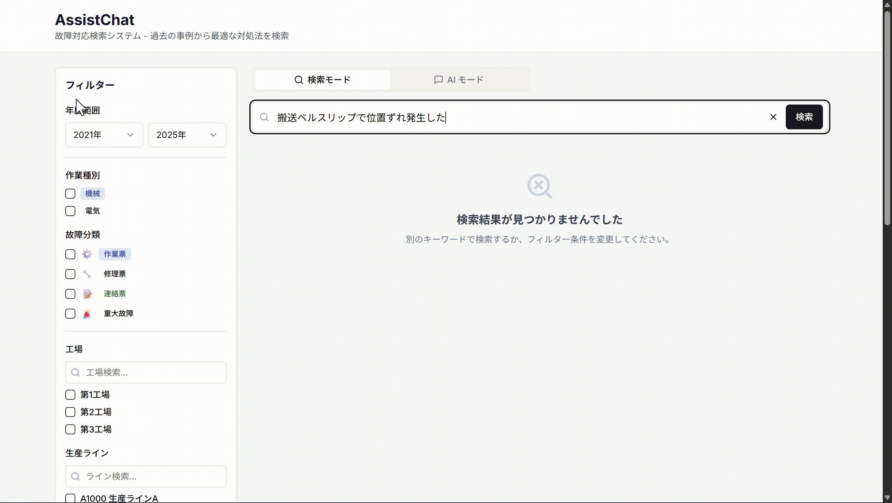
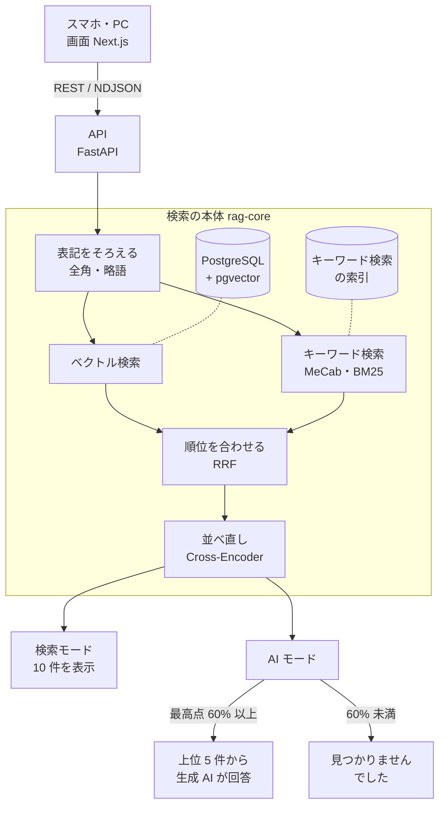

# AssistChat


**工場の保全記録を、普段の言葉で探せる検索アプリです。**

## できること

- 症状やエラーコードを入れると、似た故障の記録を 10 件表示します
- 年度・工場・ライン・設備・記録の種類などで絞り込めます
- AI モードでは、似た記録をまとめて読み、考えられる原因・優先して確認する点・対処の手順を、引用元つきで整理します
- スマホの画面でも使えます

## デモ




デモのデータは、ガラス加工工場を想定した架空のもの（2,000 件）で、会社の保全記録は入っていません。

## 作ったきっかけ

設備保全の仕事をしていた工場は広く、設備もたくさんありましたが保全は人手不足でした。設備一台一台の癖をよく知り、長年の勘が働くベテランも、ここ数年で減っており今後もさらに減る見込みでした。一方で故障対応の記録は都度詳細に書くので、過去の記録は大量に蓄積されており、どう直し、どんな対策をとったかというベテランのノウハウが詰まっていました。

ところが、その記録はあまり活用されていませんでした。原因は、記録システムの探しにくさにあったと思います。探すときは「工場 → ライン → 設備」とたどるしかなく、言葉では検索できないうえに動作も遅かったので、膨大な記録の中から似た故障を見つけるのは困難でした。しかも、使えるのは現場から遠く離れた控室の PC だけで、手元のスマホからは開けませんでした。ライン停止中にもかかわらず、移動も含めると調べものに 30 分近くかかることも珍しくありませんでした。

現場では、こんな人たちが困っていました。

| 困って いた人  | 困っていたこと                                                                                      |
| ------- | -------------------------------------------------------------------------------------------- |
| 若手      | 初めて対応する設備の故障でも、先輩や上司の付き添いが困難な場合も多く、1 人での対応を強いられて苦戦する（自分の悩みでもありました）                           |
| 夜勤の 保全班 | 工場内の全ラインを横断して受け持つので、癖のある設備や最近の故障の傾向まで把握しきれず、知っていれば 10 分程度で完了する対応にも 120 分以上かかってしまうことが度々あった |
| ライン 作業者 | 設備の調子が悪いと保全班に連絡して対応してもらうが、その設備で過去にどんな故障があり、保全班がどう対応したのか分からない                                    |

設備が 120 分を超えて止まると「重大故障」になり、生産に響くうえ、なぜなぜ分析や再発防止にも多くの時間を取られます。

過去の記録をすぐに探せれば、こうした長い停止は防げるはずだ、と思ったのがきっかけです。社内スマホが 1 人 1 台配られ、現場に持ち込める端末はそろっていました。そこで、故障した設備の前でスマホからも開けて、「ALM1102 出て途中で止まった」のような言葉で似た故障の記録が見つかるアプリを、業務時間外に個人で作りました。

会社の記録を扱うので、作り始める前に情報システム部門に相談し、使う技術を認めてもらいました。作業は会社の PC だけで行い、検索に使うモデルも社内で動かして、記録を社外のサービスに送らない作りにしました。AI モードは、社内の生成 AI（ChatAGC）につなぐ許可をもらいました。控室の PC や社内スマホから開けるようにする設定も、情報システム部門にお願いしました。

このアプリを作っていたことで、会社の正式な RAG 開発にも声をかけてもらいました。このリポジトリは、会社の PC で作ったものを、自分の PC で作り直した公開用のデモです。

**開発期間**：2024 年 9 月〜2025 年 6 月

## しくみ



## 工夫したところ

**1. 検索モードと AI モードを分けました**

検索モードは生成 AI を呼ばないので利用料がかからず、1 回 0.5 秒ほどで似た記録を順に出せます。似た記録がいくつも出て、何から確かめればいいか迷ったときだけ AI モードを使います。

会社では AI モードに ChatAGC を使っていましたが、このリポジトリはデモ版なので、代わりに OpenAI の API を使っています。

**2. 2 種類の検索を組み合わせました**

ベクトル検索だけではエラーコードの完全一致に弱かったので、単語の一致で探すキーワード検索と合わせました。最後に、質問と記録を組にして採点する、手元で動くモデルで並べ直します。「カタンカタン鳴る」と書いても「ガタガタ鳴る」の記録が見つかり、「ALM1102」のようなエラーコードでも見つかります。

**3. 人によって違う書き方をそろえました**

同じ部品でも、「モーター」「モータ」「MTR」、「コンベア」「CV」のように、書く人によって表記がばらばらです。検索の前に、略語を元の言葉に戻し、全角の英数字を半角にし、「止まった」と「止まる」のような語の形もそろえてから探すようにしました。索引を作るときと質問を受けるときに同じ処理をかけるので、どの書き方で入れても同じ記録が見つかります。

**4. 使われ方を後から測れるようにしました**

使った人へのヒアリングだけでなく、検索した言葉・開いた記録・「役立った」「役立たない」のどちらが押されたかを、検索ごとの ID でつないで残しています。週ごとに、何も開かれなかった検索の割合や役立った割合を集計でき、探せなかった質問は評価用の候補として書き出します（`tools/analyze_usage.py`）。

## 評価の結果

会社の保全記録（実データ数万件）で、4 つの検索のやり方を比べました。自分で書いた 52 問のうち、正解が無かった 8 問を除いた 44 問です。

| 方式 | 上位 5 件に正解が入った割合（Hit@5） | 最初の正解の順位の高さ（MRR@5） |
|---|---:|---:|
| ベクトル検索だけ | 0.47 | 0.32 |
| キーワード検索だけ | 0.62 | 0.48 |
| 組み合わせただけ | 0.64 | 0.45 |
| 組み合わせ＋並べ直し（採用） | 0.72 | 0.61 |

MRR@5 は、最初の正解が 1 位なら 1、2 位なら 0.5、5 位までに無ければ 0 として、44 問で平均した値です。組み合わせただけの MRR@5 がキーワード検索より低いのは、2 つの順位を混ぜると、最初の正解が少し後ろに下がることがあるためです。

### 測り方

正解データ（質問と、その答えになる記録の組）が無く、保全員に評価の時間をもらうのも難しかったので、現場を知っている自分で質問と正解を作って測りました。

- **質問**：現場の人が入れそうな質問を、検索結果を見る前に書き、あとから差し替えていません
- **正解の候補**：質問ごとに、ベクトル検索（全件を正確に比べるもの）とキーワード検索の上位 10 件を集め、どの方式の結果か分からないように並べ替えます（プーリング）
- **正解**：「同じ原因・同じ処置で、そのまま対応の参考になる記録」としました。AI に下書きの判定をさせ、全件を自分で確認しました。候補の中に正解が 1 件も無かった質問は、数字から除いています
- **見る範囲**：上位 5 件です。画面には 10 件出しますが、現場の人が目を通すのは上の数件だからです

## 作ってきた順番

1. **試作**：LangChain と FAISS で、ベクトル検索だけのものを作りました。専門用語（「チャッキングミス」「リミットスイッチ」）やエラーコードの完全一致に弱いことが分かりました
2. **検索の組み合わせ**：キーワード検索を足し、最後に並べ直すようにしました
3. **作り直し**：FAISS と LangChain をやめ、PostgreSQL + pgvector と自分で書いた検索の流れに置き換えました。再起動のたびに索引を作り直す手間をなくし、しくみを自分で説明できるようにするためです
4. **Web アプリ化**：現場のスマホから開けるように、Next.js と FastAPI で Web アプリにしました
5. **評価して直す**：評価のしくみを作って最初の状態を測り、1 つずつ直しました

## 苦労したこと・学んだこと

副業で RAG の案件に関わったときは Web 側の担当で、LangChain の部分はほかのメンバーが作っており、コードを読んでも仕組みが分かりませんでした。AssistChat の試作も LangChain で作りある程度理解したものの、なぜその記録が出てくるのかを説明できませんでした。本格的に作る際には仕組みを理解したい好奇心もあって LangChain をやめて、ベクトル検索・キーワード検索・並べ直しを一つずつ自分で書き直して、RAGの理解を深めることができました。

もう一つ苦労したのは、記録を社外のサービスに送れないことでした。手軽な外部の API やクラウドのデータベース（Pinecone など）が使えず、楽な手段が取れないことが多くありました。社内で動く埋め込みと並べ直しのモデルを探して組み合わせ、PostgreSQL + pgvector も社内に用意しました。

- **測ってから直す**：感覚で直すと、良くなったのかが分かりません。先に物差しを作るのが近道でした
- **現場の言葉で考える**：保全員が実際にどう入力するかを想像して、質問や表記の揺れを考えました。現場にいたことが一番活きたところです
- **AI や技術記事を使っても、確かめるのは自分**：コードの多くは、Qiita や Zenn などの技術記事を参考にしたり、AI（Claude Code）を使ったりして書きましたが、直す内容を小さく区切り、直す前と後を比べて確かめました。たとえば「異音」で探すと純水装置の「イオン交換樹脂」の記録まで出てきたので調べると、単語を読み（イオン）でそろえていたのが原因で、辞書の見出し語でそろえるように直しました
- **周りを巻き込む**：現場の同僚や先輩には設計の段階から見てもらい、ある程度できたところで実際に使ってもらって、感想や改善点を聞きました。情報システム部門や副業先の CEO にも相談しながら進めていく中で、自分一人では気づけない視点をもらえることを実感しました

## 使った技術

| 分野     | 技術                                                                             |
| ------ | ------------------------------------------------------------------------------ |
| 画面     | Next.js 15、TypeScript、Tailwind CSS、shadcn/ui                                   |
| API    | FastAPI、Python 3.11                                                            |
| 検索     | PostgreSQL + pgvector、BM25、MeCab                                               |
| 埋め込み | paraphrase-multilingual-mpnet-base-v2 |
| 並べ直し | mmarco-mMiniLMv2-L12-H384-v1 |
| AI モード | OpenAI API（gpt-4o-mini）                                                        |
| 実行環境   | Docker Compose、GitHub Actions                                                  |
| テスト    | pytest、vitest（lint・型チェック・ビルドと合わせて、GitHub Actions で毎回実行）                        |

## 動かし方

```bash
git clone https://github.com/RyugoHori/AssistChat-Portfolio.git
cd AssistChat-Portfolio
cp .env.example .env          # AI モードを使うときだけ OPENAI_API_KEY を入れます
docker compose up --build
```

初回だけ、索引を作ります。

```bash
docker compose exec rag-api bash -lc "\
  python /app/tools/index-builder/preprocess.py --input /app/data/demo/demo_logs.csv --output /app/data/processed && \
  python /app/tools/index-builder/build_index.py --input /app/data/processed/chunks.jsonl --output /app/data/indices"
docker compose restart rag-api
```

http://localhost:3000 で開けます（API の説明は http://localhost:8001/docs ）。

AI モードは API キーが無いと動きませんが、検索はそのまま使えます。

## 作者

Ryugo Hori（[@RyugoHori](https://github.com/RyugoHori)）
