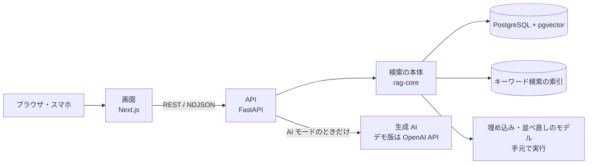

# 設計のまとめ

AssistChat のしくみと、作りながら判断したことをまとめました。

## 全体の構成

| フォルダ | 中身 |
|---|---|
| `apps/assist-chat` | 画面（検索、絞り込み、詳細、フィードバック、AI モード） |
| `services/rag-api` | API（検索、詳細、絞り込みの候補、AI モード、フィードバック、利用ログ） |
| `packages/rag-core` | 検索の本体（表記の正規化、単語への分割、索引、組み合わせ、並べ直し、LLM とのやり取り） |
| `tools` | デモデータの生成、索引の作成、評価、利用ログの集計 |
| `database/migrations` | テーブルと索引を作る SQL |

## 検索の流れ

1. 質問の表記をそろえます（全角・半角、略語）。索引を作るときにも同じ処理をしています
2. 絞り込みがあれば、条件に合う記録を先に決めます
3. ベクトル検索とキーワード検索で、それぞれ上位 10 件を取ります
4. 2 つの順位を RRF（k=60）で合わせます。各リストの順位 r（1 位を 1 とする）について 1/(60+r) を足します。k=60 は、この式でよく使われる値です
5. 上位 10 件を Cross-Encoder（質問と記録を組にして採点し直すモデル）で並べ直し、その 10 件を返します

キーワード検索では、MeCab で文を単語に分け、語を基本形にそろえてから BM25 で点数をつけています。

## 作りながら判断したこと

### 検索モードと AI モードを分ける

- **考えたこと**：過去の記録を読めば直せる故障に、毎回 AI の回答はいりません。AI を呼ぶと、回答が出るまで数秒かかり、利用料もかかります
- **やったこと**：検索モードを基本にして、原因の切り分けや手順の整理まで欲しいときだけ AI モードを使う形にしました。検索結果の「AI に質問」から、その事例を起点に聞けます
- **AI の答え方**：検索で見つかった記録のスコア（下の「スコアの表示をそろえる」）の最大が 0.6 に届かないときは、AI に回答を作らせず「見つかりませんでした」と返します。答えるときは、根拠にした記録を一緒に出します。AI への指示でも、記録に書かれたことだけを根拠にするよう決めています

### 2 つの検索を組み合わせ、最後に並べ直す

- **きっかけ**：最初はベクトル検索だけで作りましたが、専門用語やエラーコードの完全一致に弱いことが分かりました
- **やったこと**：キーワード検索を足して順位を合わせ、最後に Cross-Encoder で並べ直すようにしました
- **結果**：会社の保全記録の評価Aでは、キーワード検索だけの Hit@5 が 0.62、組み合わせ＋並べ直しが 0.72 です。MRR@5 は、組み合わせただけだと 0.45 で、並べ直すと 0.61 です。公開デモでは、並べ直しを入れると 13 問で順位が上がり、下がった問題はありませんでした。数字は [評価のまとめ](EVALUATION.md) にあります

### ベクトル検索の索引を HNSW に変える

- **きっかけ**：最初の索引（IVFFLAT）で評価の質問 5 問を確かめたところ、全件を正確に比べた結果と上位 10 件が 1 件も重なりませんでした。IVFFLAT はベクトルをグループに分ける近似で、lists=100 はグループ数、probes=1 は見るグループが 1 つだけ、という意味です
- **やったこと**：pgvector の HNSW（近いベクトル同士をつないだグラフをたどる索引。既定の設定）に変えました
- **結果**：公開デモの評価B（症状文を質問にする測り方）で、ベクトル検索だけの Hit@5 が 0.62 から 0.77 に上がりました

### 絞り込みを先にかける

- **きっかけ**：ラインや工場で絞ると、0〜1 件しか出ないことがありました
- **原因**：上位 10 件を取ってから条件で絞っていたので、条件に合う記録がそもそも候補に入っていませんでした
- **やったこと**：条件に合う記録を先に決めて、その中から上位を取るようにしました。ベクトル検索は、このときだけ索引を使わずに全件と比べます。公開デモの 2,000 件では、速さは問題になりませんでした
- **結果**：絞り込んでも、表示する件数までそろって出るようになりました

### 検索を 1 本ずつ処理する

- **きっかけ**：同じ検索を 8 本同時に投げて確かめると、18 回中 1 回で、1 本ずつのときと結果が食い違いました
- **原因**：検索用の DB のカーソルと、埋め込みモデル・並べ直しモデルのトークナイザーを、全リクエストで共有していました。どちらも別のスレッドから同時には使えません
- **やったこと**：検索全体をロックで 1 本ずつ処理するようにしました
- **結果**：食い違いは 0 回になりました。公開デモでは 1 回 0.3 秒ほどなので、1 本ずつでも待ちは小さいです

### 埋め込みの長さは変えない

- **気になったこと**：埋め込みのモデルは 128 トークンで文を切るので、長い記録の後ろが無視されているかもしれないと思いました
- **確かめたこと**：記録を数えると、128 トークンを超えるのは 2,000 件中 68 件（3.4%）で、はみ出す分も最大 20 トークンでした
- **判断**：今は変えないことにしました。長い記録を扱うときに見直します

### スコアの表示をそろえる

- **きっかけ**：並べ直しの点数が 0〜1 のときだけ別の計算をしていたので、順位が上なのにスコアの % が低く出ることがある作りになっていました
- **やったこと**：並べ直しの点数は、いつも同じ式（`(点数 + 10) / 20`）で % にするようにしました。AI モードの信頼度（高・低）も、この値の最大が 0.6 以上かどうかで決めています

### 記録を外に出さない

- 検索に使うモデルはすべて手元で動かしていて、検索モードでは記録は外に出ません
- AI モードだけは、上位の記録を生成 AI に渡して回答を作ります。会社では社内の ChatAGC、このデモでは OpenAI です。呼び出す所は `packages/rag-core/rag_core/llm.py` の 1 か所です
- エラーが起きても、内部のエラーの中身は画面や API の応答に出さないようにしています

## API

| メソッド | パス | 内容 |
|---|---|---|
| POST | `/api/search` | 検索（`query`、`filters`、件数 `k` は 1〜10） |
| GET | `/api/search/metadata` | 絞り込みの候補（工場・ライン・設備の階層、年度の範囲） |
| GET | `/api/docs/{doc_id}` | 記録の詳細 |
| POST | `/api/chat` | AI モード。進み具合、引用元、回答を、改行区切りの JSON（NDJSON）で順に返します |
| POST | `/api/feedback` | 「役に立った」「立たなかった」の記録 |
| GET | `/health`、`/api/stats` | 動いているかの確認と件数 |

## 利用ログ

検索、詳細を開いた操作、フィードバックを、検索ごとの ID でつないで記録しています。`tools/analyze_usage.py` で、週ごとの「役に立った」の割合や、何も開かれなかった検索の割合を集計できます。デモ版には利用者がいないので、数字は載せていません。

## DB と索引

- テーブルと索引は、DB が空の状態で初めて起動したときに、`database/migrations` の SQL で作られます
- 索引は `tools/index-builder` で作ります（前処理 → 埋め込み → pgvector とキーワード検索の索引）。作り直すたびに、HNSW の索引も同じ名前で作り直します
- すでにある DB に、あとからマイグレーションを当てるときは `database/run_migrations.py` を使います

## テスト

- バックエンド：pytest（検索、絞り込み、同時実行、LLM まわり、API）、ruff（書き方のチェックと整形）
- 画面：vitest、ESLint、型チェック、ビルド
- GitHub Actions で、上のすべてを回しています
